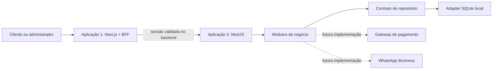

# Arquitetura

## Fronteiras de execução



O navegador usa rotas relativas `/api`. O BFF controla o cookie HttpOnly e encaminha a sessão ao backend; o token não é devolvido ao JavaScript do cliente. O backend decide permissões, preços, descontos, disponibilidade, pagamento e finalização. Todas as operações com registros são limitadas ao tenant autenticado.

O destino do backend é uma configuração de servidor (`BACKEND_URL`), não uma URL recebida do navegador. O BFF permite somente rotas previstas, verifica a origem nas operações de escrita e usa timeout e `no-store` para dados privados. Os dados bancários não são expostos às contas de clientes.

## Organização modular

No backend, os módulos com funcionalidades implementadas possuem:

```text
modules/<business-module>/
  domain/                       tipos e estados do domínio
  application/                  operações e validação de entradas
  infrastructure/controller/    adaptadores HTTP
  <business-module>.module.ts   composição e interface pública
```

Módulos: identity, customers, catalog, appointments, checkout, triage, feedback, loyalty, promotions, notifications, settings e insights. Pagamentos e mensagens externas têm contratos para futuras implementações, sem adapters ativos.

O `core` concentra identidade compartilhada, políticas puras de datas/descontos e o contrato de persistência. O adapter SQLite é selecionado por injeção de dependência. Controllers delegam as operações aos serviços de aplicação; regras de cálculo ficam fora da interface visual. A camada de aplicação usa NestJS para DI e erros HTTP: o isolamento do framework é pragmático, não absoluto.

No frontend, os módulos se organizam por funcionalidade, com componentes de apresentação independentes. Contratos de leitura e formatação ficam no módulo shared, e o cliente HTTP fica na infraestrutura. As telas secundárias são carregadas sob demanda. O BFF fica em um módulo de servidor e nas rotas de entrada do App Router.

## Consistência e desempenho implementados

- Valores monetários em centavos inteiros e preços preservados nos itens do pedido.
- Checkout, reserva de horários e consumo de cupom dentro de uma única transação `BEGIN IMMEDIATE`.
- Chave de idempotência por cliente e verificação do conteúdo do pedido.
- Validação de total esperado para impedir confirmação silenciosa de uma cotação alterada.
- Chaves compostas por loja, coleção e registro; índices por proprietário para consultas de clientes/notificações.
- Consultas de leitura de clientes são filtradas no adapter quando aplicável, além da autorização na aplicação.
- Notificações de eventos recorrentes têm identificador determinístico; uma repetição não produz duplicatas.
- O BFF agrega as leituras iniciais em paralelo; dados de telas secundárias são buscados ao abrir o módulo.
- Gráficos da agenda usam CSS e dados calculados pelo backend; não há biblioteca pesada de gráficos.
- SQLite em WAL e timeout de bloqueio para a instância local.

Os índices e decisões de projeto não substituem teste de carga. Há consultas administrativas que ainda leem coleções inteiras, o que limita a escala da implementação atual.

## Persistência e evolução

O adapter local armazena documentos JSON em SQLite. Essa escolha torna a demonstração persistente e executável sem infraestrutura externa. As invariantes de horários e cupons dependem da serialização das transações dessa base.

Para operação em múltiplas instâncias, a próxima evolução é um adapter PostgreSQL com tabelas por agregado, migrações versionadas, consultas paginadas, agregações no banco e restrições para intervalos de agenda. Deve preservar o contrato externo da API e os cenários de consistência já testados. Não copiar o mecanismo de reserva local para processos concorrentes sem validar as garantias do novo banco.

O ReminderWorker roda no backend a cada 30 segundos. Antes de distribuir o processamento, substituir o timer por execução durável, com agendamento, retries, outbox transacional e idempotência por evento. A atualização visual periódica não é responsável por finalizar atendimentos.

Uma implantação real ainda precisa definir hospedagem independente para Next.js e NestJS, domínio/HTTPS, banco persistente, política de backups e monitoração. Este repositório contém somente o backend; o frontend/BFF está no repositório front-compasso-web. Os dois processos Node são executados e implantados separadamente.

## Integrações futuras

Após selecionar o gateway, implementar `PaymentGateway`, criar checkout no servidor e confirmar pagamentos exclusivamente a partir de notificações autenticadas e reconciliadas com pedido, tenant, moeda e valor. Eventos de webhook precisam de persistência e deduplicação. Não confiar em retorno do navegador como comprovante de pagamento.

Após validar a conta na Meta, implementar `MessageGateway`, os templates aprovados e a entrega por canal. Os links `wa.me` atuais abrem uma conversa para envio humano e não representam uma integração com a API do WhatsApp.

A busca interna multiloja precisa de um provedor de ofertas. Os atalhos atuais não fazem scraping nem afirmam consultar preços em tempo real.
